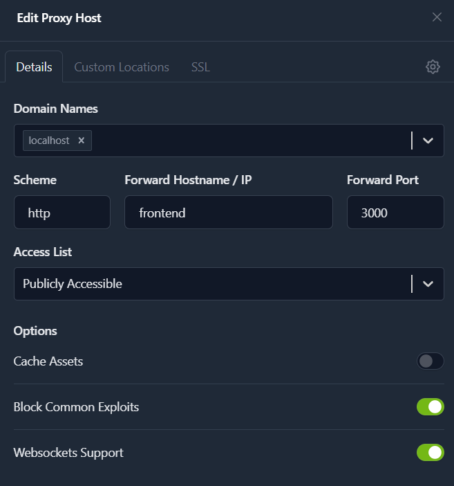
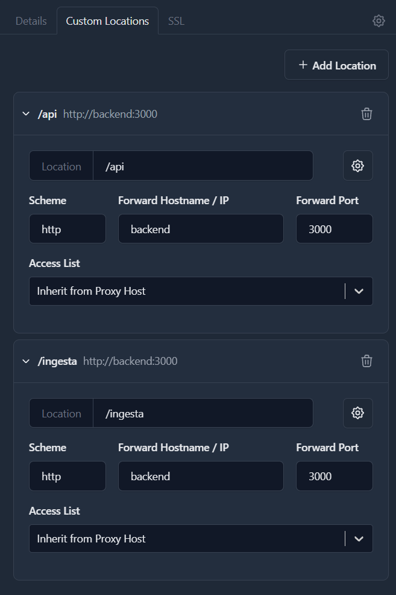

# Guía de Despliegue en Windows


## 1. Requisitos Previos

- **Docker Desktop** para Windows instalado y en ejecución.

- Copia del repositorio (rama `main`) en una carpeta local (consulte la documentación del `README` principal).


---


## 2. Pasos para el Despliegue Local


1. Abrir **PowerShell** e ingresar a la carpeta del proyecto.

2. Navegar al directorio del servidor:

   ```bash

   cd ./server

   ```

3. Construir y ejecutar los contenedores (*Nginx Proxy Manager, Base de Datos, Backend, Analítica, Frontend y Broker MQTT*):

   ```bash

   docker-compose up -d --build

   ```

4. Verificar que los servicios estén activos (también visible en la interfaz de Docker Desktop):

   ```bash

   docker ps

   ```

5. Sembrar la base de datos con los roles, las cuentas de las personas y la estructura de equipos. Este paso solo hace falta la primera vez o cuando se quiere reiniciar la base de datos.

   ```bash

   docker-compose exec backend npm run seed

   ```

6. Cargar los datos sintéticos de analítica. Estos datos sirven solo para las pruebas y corresponden a ocho semanas de eventos de dos personas. El comando carga los eventos, vuelve a procesar ese periodo y recalcula las correlaciones, todo en una sola corrida. Antes de ejecutarlo hay que haber corrido el sembrado del paso anterior, porque usa las cuentas que ese paso crea.

   ```bash

   docker compose exec -e ALLOW_DEMO_DATA=1 analytics python load_data.py

   ```

7. Consultar las credenciales generadas para la prueba (*se escriben en un archivo interno dentro del contenedor*):

   ```bash

   docker-compose exec backend cat .seed-credenciales.txt

   ```

8. Configurar el enrutamiento en la consola web de **Nginx Proxy Manager**:

   - Acceder a http://localhost:81

   - Crear una cuenta inicial (correo y contraseña).

   - Ir a **Hosts -> Proxy Hosts -> Add Proxy Host**.

   - Configurar los datos de red como se ilustra a continuación:


<div align="center">

  

  <p><em>Figura 1: Configuración inicial del Proxy Host en Nginx.</em></p>

  <br />

  

  <p><em>Figura 2: Parámetros adicionales de enrutamiento.</em></p>

</div>


9. Acceder al dashboard de la aplicación en el navegador: http://localhost

10. Acceder a la documentación de la API de analítica (*disponible solo en despliegue local*): http://localhost:8000/docs


### Detención del Entorno

Para apagar los contenedores manteniéndolos en su estado actual, ejecute:

```bash

docker-compose down

```


---


## 3. Variables de Entorno y Secretos


> **Nota:** En desarrollo local los contenedores utilizan valores por defecto.


Para un despliegue real, se debe crear un archivo `.env` en la carpeta `server` tomando como referencia el archivo `backend/.env.example`. En este se definen variables críticas como `POSTGRES_PASSWORD`, `JWT_SECRET` e `INGEST_TOKEN` con cadenas aleatorias y seguras. 


> **Advertencia:** El archivo `.env` y el archivo de credenciales de demostración **nunca** deben subirse al repositorio de control de versiones.


---


## 4. Configuración para Entorno de Producción


En producción, el backend exige secretos propios y habilita verificaciones de seguridad que impiden el arranque con credenciales predeterminadas.


### Procedimiento de Configuración


1. **Generar secretos aleatorios:**  

   Ejecutar el siguiente bloque en PowerShell (crea tres cadenas aleatorias de 64 caracteres):

   ```bash

   $db  = -join (1..64 | ForEach-Object { '{0:x}' -f (Get-Random -Maximum 16) })

   $jwt = -join (1..64 | ForEach-Object { '{0:x}' -f (Get-Random -Maximum 16) })

   $ing = -join (1..64 | ForEach-Object { '{0:x}' -f (Get-Random -Maximum 16) })

   ```


2. **Crear el archivo `.env`:**  

   Aplica las variables generadas automáticamente (*remplaza `https://dominio-del-frontend` con el dominio real servido bajo HTTPS, o `http://localhost` para pruebas locales*):

   ```bash

   @"

   POSTGRES_PASSWORD=$db

   JWT_SECRET=$jwt

   INGEST_TOKEN=$ing

   CORS_ORIGIN=https://dominio-del-frontend

   "@ | Set-Content -Path .env -Encoding utf8

   ```


3. **Activar el modo producción (`docker-compose.override.yml`):**  

   Cree el archivo `docker-compose.override.yml` en la carpeta `server` para sobrescribir las variables sin modificar el archivo base (este archivo ya está ignorado en `.gitignore`):

   ```yaml

   services:

     backend:

       environment:

         - NODE_ENV=production

   ```


4. **Reconstruir y levantar el stack:**  

   Al cambiar la contraseña de la base de datos, es necesario recrear el volumen de almacenamiento:

   ```bash

   docker-compose down -v

   docker-compose up -d --build

   ```


5. **Verificar el arranque del servicio:**  

   Consulte los registros para confirmar que la aplicación está escuchando peticiones:

   ```bash

   docker-compose logs backend --tail 10

   ```

   *Si el contenedor entra en un bucle de reinicio indicando que no puede arrancar con secretos por defecto, revise la creación del archivo `.env`.*


6. **Sembrado de datos:**  

   Ejecute `docker-compose exec backend npm run seed`. Este comando crea las cuentas de las personas con una clave temporal que cada una debe cambiar la primera vez que entra. Las claves quedan guardadas en el archivo `.seed-credenciales.txt`, que se debe entregar por un canal seguro y luego borrar del servidor. En producción no se cargan los datos sintéticos de analítica, porque esos datos solo sirven para las pruebas.


> **Restauración a Desarrollo:** Borre los archivos `.env` y `docker-compose.override.yml` de la carpeta `server` y reinicie el stack.


---


## 5. Reinicio Limpio de la Base de Datos


Los datos persistentes se almacenan en el volumen administrado por Docker llamado `db_data` (externo al árbol de archivos del repositorio). 


* Los datos persisten entre reinicios normales con `docker-compose down` y `docker-compose up`.

* Para un **reinicio completo a cero**, ejecute el siguiente comando para remover los contenedores junto con sus volúmenes asociados:


```bash

docker-compose down -v

```


El esquema de la base de datos se vuelve a crear solo en el siguiente arranque. Después queda listo para ejecutar otra vez el sembrado con `npm run seed` y, si se trata de un entorno de pruebas, la carga de los datos sintéticos de analítica que aparece en el paso 6 de la sección 2.